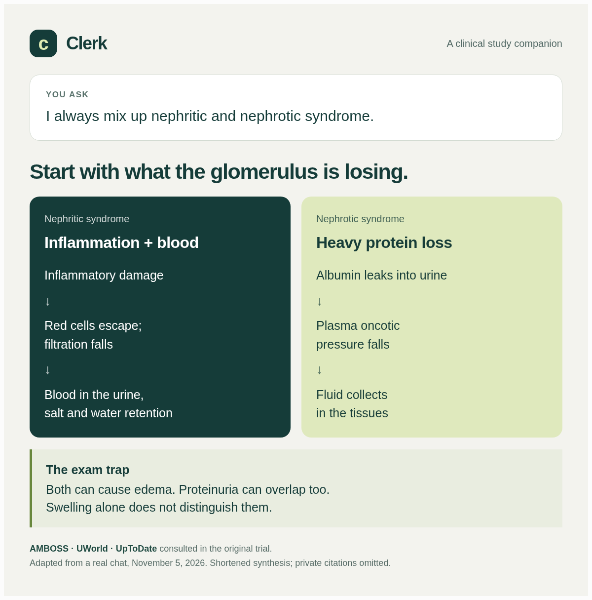
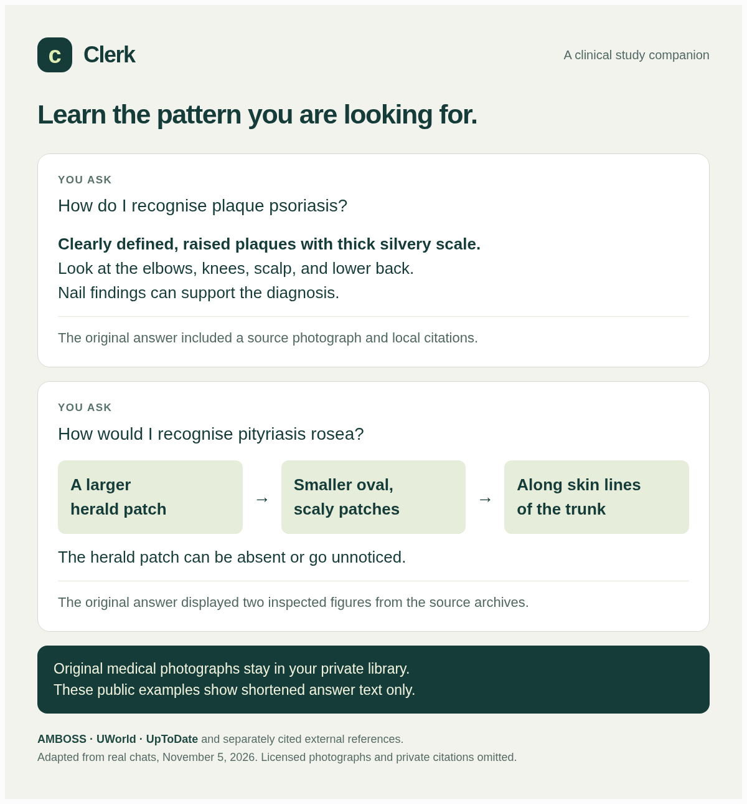

# Clerk

### A clinical study companion. Your agent, your model, your medical libraries.

Ask the question you would ask a friend on the ward. Clerk helps your AI agent search your medical references, explain the answer, and show you where it came from.

> "I always mix up nephritic and nephrotic syndrome."
>
> "How would I recognise pityriasis rosea?"
>
> "Why can potassium be high in DKA if the patient is losing potassium?"

No special prompt to memorise. No need to ask for citations every time. The project instructions tell your agent to retrieve evidence, compare the available libraries, and choose a useful table or source image when it helps.

[Get started](#get-started-without-coding) · [Human setup guide](docs/getting-started.md) · [Agent setup guide](docs/agent-install.md) · [Example answers](#see-it-in-action)

## The AMBOSS GPT alternative for multi-library study

If you like asking AMBOSS GPT medical questions, Clerk gives you a reason to try a different setup: **bring AMBOSS, UWorld, and UpToDate into the same conversation, with the agent and model you choose.**

| What you want while studying | What Clerk adds to your agent |
| --- | --- |
| Understand why something happens | Explanations grounded in passages retrieved from your local references. |
| Compare what different libraries say | Searches across all three supported libraries by default, with meaningful differences explained. |
| Check the answer yourself | Local citations with the source title, passage, surrounding context, and available dates. |
| Recognise what a condition looks like | Original source images and readable tables, when available in your archives and supported by your chat app. |
| Keep using your favourite AI | Project instructions, skills, and a local command-line tool, with no model-specific API integration. |

[AMBOSS documents its GPT](https://support.amboss.com/hc/en-us/articles/33872741080081-AMBOSS-GPT) as searching the AMBOSS library and linking relevant articles. Clerk's reasons to switch are the multi-library workflow, local evidence checks, and choice of agent. We have not completed a head-to-head answer-quality benchmark, and Clerk's dated archives do not establish current clinical guidance. [Comparison notes](docs/amboss-comparison.md).

## See it in action

These examples come from real trial chats on November 5, 2026. The cards below are shortened, redesigned versions of those answers, not screenshots of a particular app. The trials used ordinary questions without instructions to cite, compare sources, or include visuals.

### When two syndromes keep blurring together



The agent searched all three libraries, checked supporting passages, and displayed a comparison. The useful part was the trap it called out: swelling alone does not distinguish them.

### When you need to recognise a rash



The original dermatology answers also displayed photographs from the source archives. These public example cards omit the source photographs. In your own chat, the agent can show the original images available in the provided archives. The trials also used separately cited external clinical references where helpful.

[Read the accessible text versions and example provenance](docs/examples.md) · [Read the trial and verification record](docs/natural-chat-validation.md)

## Use the agent you already like

Clerk is designed to be **harness agnostic and model agnostic**. That means it is not tied to one AI app or model provider. ChatGPT desktop is simply the beginner tutorial below.

Codex, Claude Code, OpenCode, T3 Code, Hermes, and other local agents can use the same files and commands when configured to load the instructions. A desktop app such as ChatGPT or Claude needs a mode that can access the folder and run local commands. An ordinary chat with uploaded files alone cannot run the search tool.

Your agent needs to:

- Read this folder and its `AGENTS.md` instructions.
- Load the project skills in `.agents/skills/`, or read them explicitly if it does not discover skills automatically.
- Run local commands such as `pnpm med search` and read the returned evidence.

Apps differ in instruction discovery and image display. If yours uses a different instruction file, ask it to read `AGENTS.md` and the linked skills. The observed end-to-end trials used T3 Code with Codex on Linux; the other clients are portability paths, not a tested compatibility matrix.

## Get started without coding

**The medical libraries are provided.** The AMBOSS, UWorld, and UpToDate archive files are attached to this repository's [library release](https://github.com/ahmadhajji/clerk/releases/tag/library-snapshots-v1). Download the small project ZIP first; your agent downloads the libraries automatically during setup and checks their identities. You do not need to find or supply separate archives. The library download is about **2.7 GiB**.

You also need a computer, an AI app that can work with local folders and commands, and access to a model through that app. Your app's usual plan, usage limits, and charges still apply. Clerk itself needs no additional API key or hosted backend.

1. **Download this folder.** [Download ZIP](https://github.com/ahmadhajji/clerk/archive/refs/heads/main.zip), or click the green **Code** button near the top of the repository and choose **Download ZIP**.
2. **Extract the ZIP.** On a Mac, double-click it. On Windows, right-click it and choose **Extract All**. Move the extracted folder somewhere you will keep it, such as Documents.
3. **Open it in ChatGPT desktop.** Sign in, choose **Codex**, and add or open a **local project** using the extracted folder. Select the folder containing `AGENTS.md` and `package.json`. If you already created a project, use **Edit project → Add folder** and make this folder primary. [Official desktop setup](https://learn.chatgpt.com/docs/quickstart) · [Local projects](https://learn.chatgpt.com/docs/projects#use-local-projects-for-folders-and-codebases).
4. **Let the agent set it up.** Start a chat in that folder and paste the message below. It will check the required tools, download the provided libraries, and build the search index. If a system installer needs your clicks, it will guide you.
5. **Start studying after setup passes.** Ask a question in the same project. For another topic, start another chat inside that project.

```text
Set up Clerk in this folder for me. Read AGENTS.md and docs/agent-install.md,
then follow the setup guide. Check the required tools and download the
provided medical libraries. Keep downloaded and generated files private.
Verify that search and source citations work before telling me it is ready.
Explain any steps I need to do in plain English.
```

You do not need Git or coding experience for the ZIP route. First-time setup downloads the libraries and builds a local search index, so it takes longer than opening a normal chat. While the repository is private, release downloads require authorized GitHub access; [the setup guide explains this](docs/getting-started.md#private-repository-downloads). Afterward, ask your medical question directly.

**Already have an agent?** Open this folder with it and paste the same setup message. **Prefer to install by hand?** Follow the [step-by-step human guide](docs/getting-started.md), including the manual commands and common fixes.

## Try your first question

- "I always mix up nephritic and nephrotic syndrome."
- "Why do red cells look different in iron deficiency and thalassemia?"
- "How do I tell SIADH from cerebral salt wasting?"
- "Explain the potassium changes in DKA, then quiz me."
- "Use UWorld only for this question."

The default is to search every available library. You can narrow the sources, ask a follow-up, or ask for a shorter explanation. Missing evidence should be reported plainly.

## What stays on your computer

The downloaded archives, search index, citations, and extracted source images live in the ignored `private/` folder. The provided archive originals are hosted in the repository's library release. Building and searching the index makes no model or embedding API calls.

**The passages and images your agent reads are included in its conversation with your chosen AI provider.** This is local retrieval, not an entirely offline AI system. Do not add identifiable patient information to study chats.

The libraries are snapshots. Their dates and coverage vary, and the agent can make mistakes. Use Clerk for study; check current authoritative guidance for patient care. Source images may be missing, search may need synonyms, and there is no OCR index or audio/video transcription.

## For contributors

Use pnpm and strict TypeScript. Run `pnpm check` before opening a PR into `main`. Keep archives, extracts, indexes, and source photographs out of commits, issues, and PRs.

- [Operations and archive custody](docs/operations.md)
- [Retrieval verification](docs/verification.md)
- [Natural-question trials](docs/natural-chat-validation.md)
- [AMBOSS comparison and its limits](docs/amboss-comparison.md)

Clerk is an independent project, unaffiliated with AMBOSS, UWorld, UpToDate, or any AI app named above. Those names identify the supported sources and possible clients.
