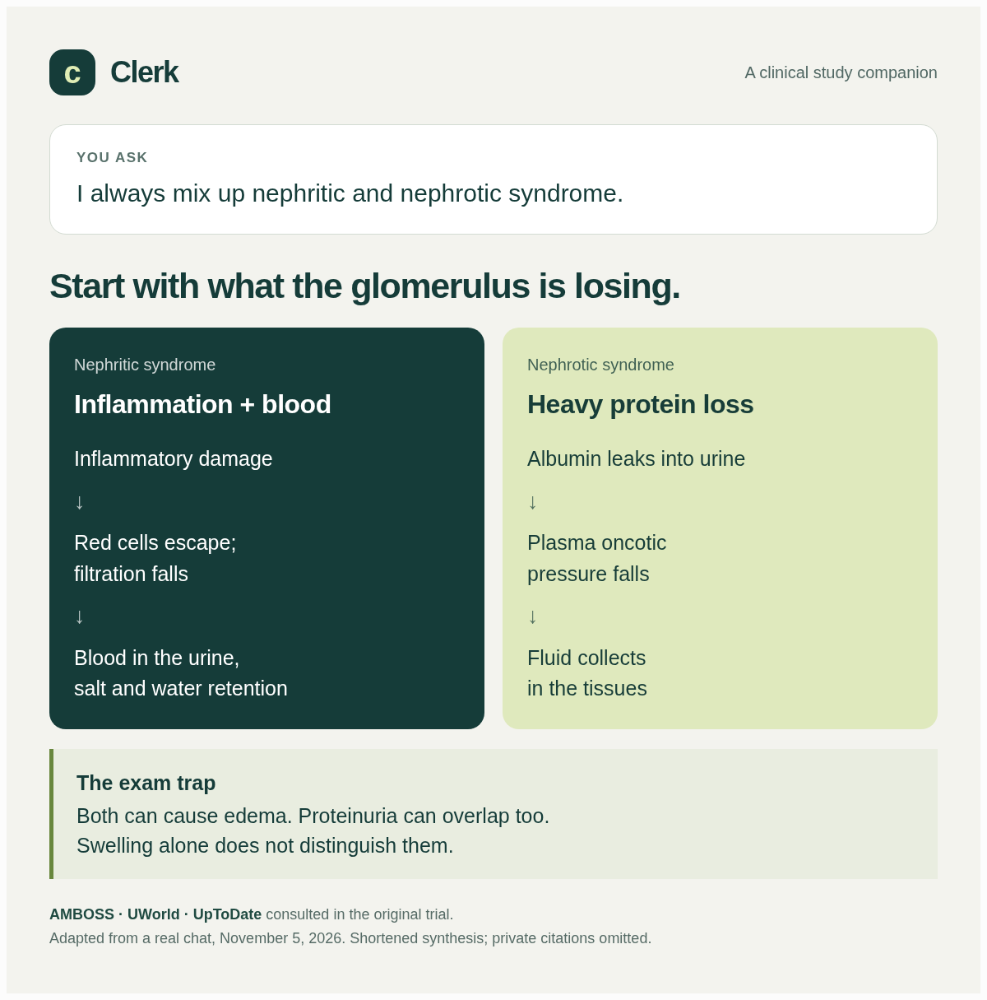
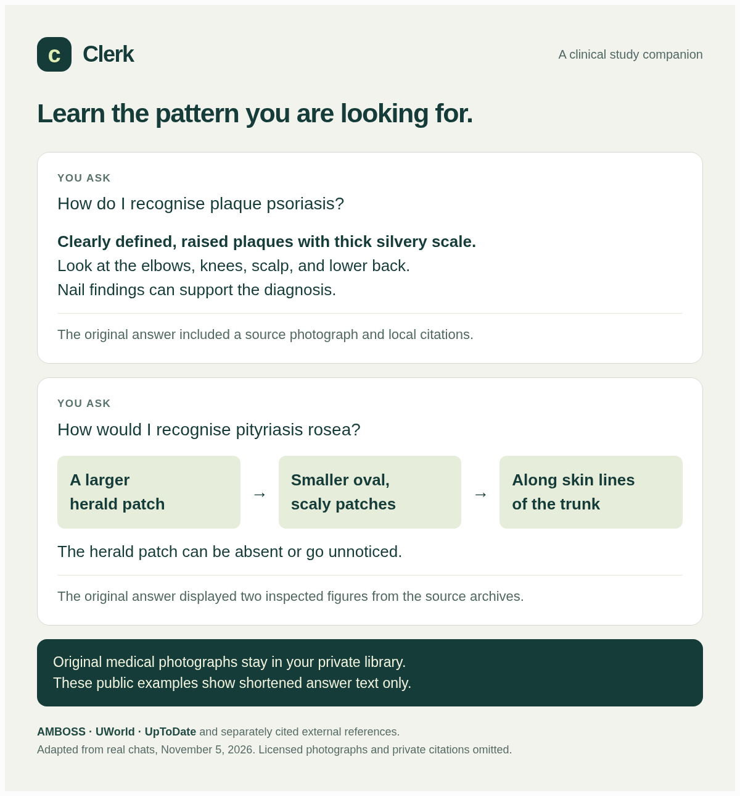

# Example chats

These examples adapt three real, separate trial chats from November 5, 2026. Each trial started with only the question shown below. The agent loaded the project skills, retrieved local evidence, and returned an answer with citations. The public cards shorten and redesign the answers; they are not literal screenshots, new clinical reviews, or a guarantee of the same wording in another app.

The full trial methodology, follow-through issues, corrections, and private thread references are in [natural-question validation](natural-chat-validation.md). Public cards contain original explanatory summaries. They omit private file paths, source extracts, and licensed source photographs. Source names identify the libraries consulted; they are not public links to the private passages.

## Nephritic versus nephrotic syndrome

**Prompt:** "I always mix up nephritic and nephrotic syndrome."

**Condensed answer:** Think inflammation and blood for nephritic syndrome, and heavy protein loss for nephrotic syndrome. In nephritic disease, inflammation damages the glomerulus, red cells escape, and filtration falls. In nephrotic disease, heavy albumin loss helps explain edema. Swelling is a poor discriminator because both syndromes can cause it; proteinuria can overlap too.

The original answer cited AMBOSS for the nephritic explanation, UWorld for protein loss, and UpToDate for overlap and qualifications. Its comparison was displayed as a diagram. The trial found that final citation targets needed to retain their absolute paths; the project instructions were then tightened.

## Plaque psoriasis

**Prompt:** "How do I recognise plaque psoriasis?"

**Condensed answer:** Look for clearly demarcated, raised plaques with thick silvery scale, commonly on the elbows, knees, scalp, or lower back. Nail findings can support the diagnosis. Recognise the overall pattern rather than relying on one examination sign.

The original answer cited all three libraries and separately cited DermNet. It displayed a VisualDx photograph through the private UpToDate archive. That photograph is not reproduced here. This early trial did not record pixel inspection before the image description; the visual skill was corrected afterward to require it.

## Pityriasis rosea

**Prompt:** "How would I recognise pityriasis rosea?"

**Condensed answer:** Think of a larger herald patch followed by smaller oval, scaly patches along the skin lines of the trunk. The herald patch may be absent or unnoticed.

The original answer cited AMBOSS, UWorld, and UpToDate, plus separately identified external dermatology references. It displayed two original source figures from the private AMBOSS and UWorld archives, inspected through the returned visual preview before display. Those figures are not reproduced here.

## What the examples establish

They demonstrate retrieval, source comparison, citations, and useful presentation in the observed T3/Codex setup. They do not establish universal accuracy, current treatment recommendations, a head-to-head win against AMBOSS GPT, or verified compatibility with every agent and model.

To try the same questions, complete [setup](getting-started.md) using your own compatible archives. Actual answers, evidence, source dates, and available images depend on those archives and your agent.
